# Deploying a Flask App on Amazon EKS

A containerized Flask app built with Docker, published to Docker Hub, and deployed on an Amazon EKS (Kubernetes) cluster behind an AWS LoadBalancer. Completed as part of the Udacity *Server Deployment and Containerization* course.

## Architecture

```
Flask app -> Docker image -> Docker Hub -> EKS Deployment (3 replicas) -> LoadBalancer Service -> Browser
```

## Tools used

AWS EKS, eksctl, kubectl, Docker, Docker Hub, AWS CLI, CloudFormation, Python/Flask, Ubuntu (VirtualBox VM)

## What I built

| Item | Value |
|---|---|
| Cluster | `eksctl-demo`, Kubernetes 1.34, region `us-east-2` |
| Nodes | 2 x `t3.medium` managed node group |
| Image | `raghuvk7/simple-flask:v1` |
| Deployment | `simple-flask-deployment`, 3 replicas |
| Service | `my-service`, type `LoadBalancer`, port 8080 |
| Result | Browser returns `Hello, World from Flask!` |

## Project files

| File | Purpose |
|---|---|
| `app.py` | Flask app, returns `Hello, World from Flask!` on `/`, listens on port 8080 |
| `Dockerfile` | Builds the image from `python:3.7.2-slim`, installs Flask, runs `app.py` |
| `deployment.yml` | Kubernetes Deployment, 3 replicas, rolling update, container port 8080 |
| `screenshots/` | Terminal and console evidence for each step |

Note: `app.py` runs with `debug=True`, which is fine for a course demo but should be turned off in production.

## Steps

### 1. Configure AWS CLI and check eksctl
Configured the lab credentials (access key, secret, session token, region `us-east-2`) and confirmed eksctl is installed.

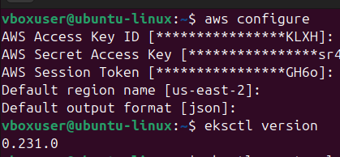

### 2. Create the EKS cluster
```bash
eksctl create cluster --name eksctl-demo --nodes=2 --version=1.34 --instance-types=t3.medium --region=us-east-2
```
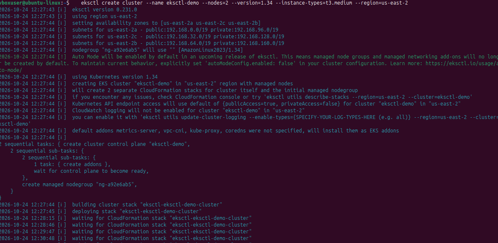

Both worker nodes reach `Ready`:

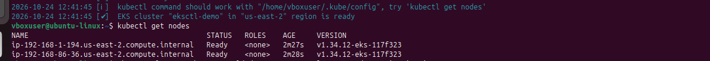

### 3. Get the app and build the image
```bash
git clone https://github.com/mraghu2020-ctrl/cd0157-Server-Deployment-and-Containerization
cd cd0157-Server-Deployment-and-Containerization/examples/Deploy_Flask_App
docker build -t raghuvk7/simple-flask:v1 .
```
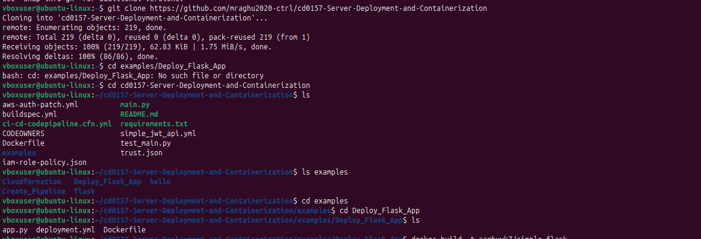
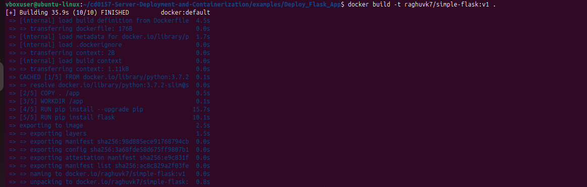

### 4. Push the image to Docker Hub
Logged in with a Docker Hub personal access token (Read & Write), then pushed:
```bash
docker login -u raghuvk7
docker push raghuvk7/simple-flask:v1
```
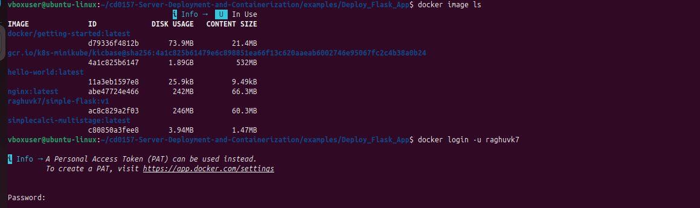
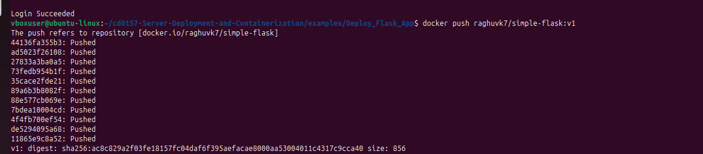
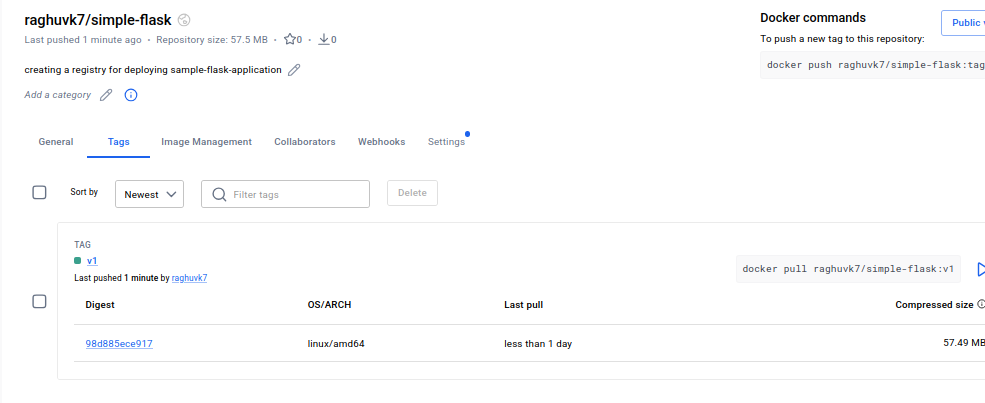

### 5. Deploy to Kubernetes
```bash
aws eks update-kubeconfig --name eksctl-demo --region us-east-2
kubectl get nodes
kubectl apply -f deployment.yml
kubectl get pods
```
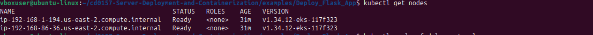
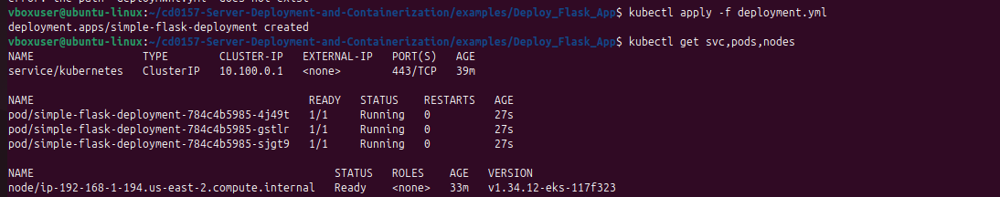
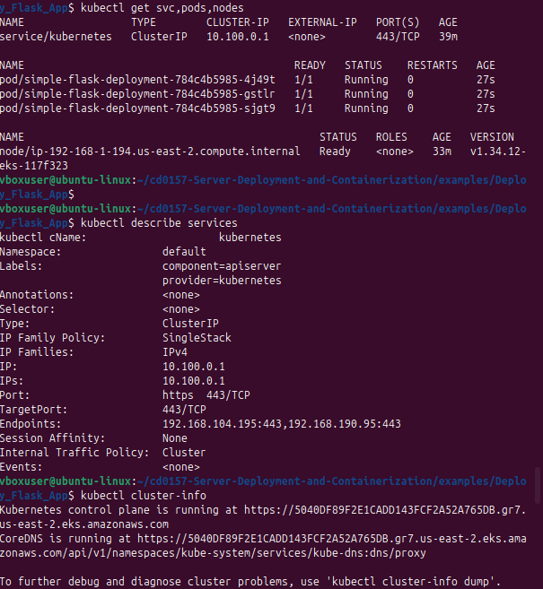

### 6. Expose the app with a LoadBalancer
```bash
kubectl expose deployment simple-flask-deployment --type=LoadBalancer --name=my-service
kubectl get svc
```
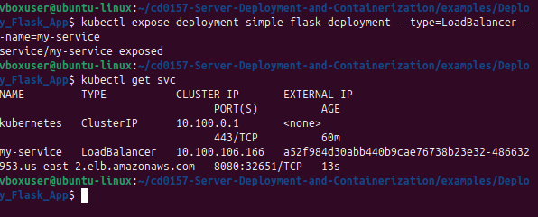

### 7. Test it
```bash
curl http://<load-balancer-dns>:8080
```
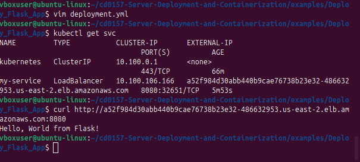
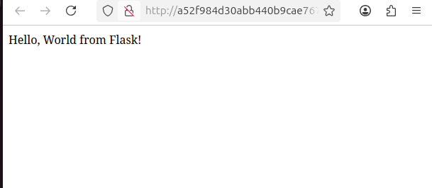

### 8. Verify in the AWS console and in the terminal
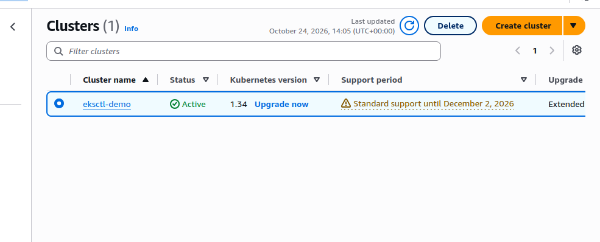
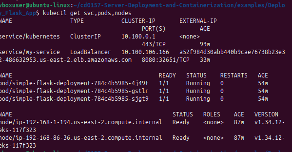

### 9. Clean up
Deleted the service first so AWS removes the load balancer, then the cluster, to avoid ongoing charges:
```bash
kubectl delete svc my-service
eksctl delete cluster --region us-east-2 --name eksctl-demo
```
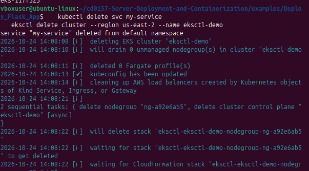

The console confirms no clusters remain:

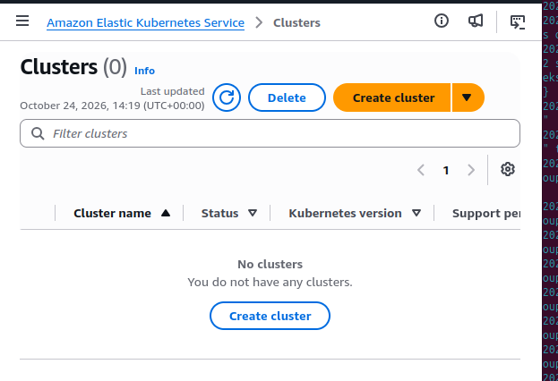

## Problems I ran into and how I solved them

| Problem | Cause | Fix |
|---|---|---|
| `AccessDeniedException` on `eks:DescribeClusterVersions` | The lab's Service Control Policy blocked the call with the credentials in use | Re-ran `aws configure` with the lab's current credentials and used a supported Kubernetes version |
| `Stack [eksctl-eksctl-demo-cluster] already exists` | A previous create had succeeded, or a delete was still running | Checked the stack status with `aws cloudformation describe-stacks`, waited for deletion to finish before recreating |
| `kubectl get nodes` showed `No resources found` / `NotReady` | The node group was still being created and add-ons were starting | Checked the node group and CloudFormation stacks, waited, and recreated the cluster with Kubernetes 1.34 |
| `docker build` failed with "requires 1 argument" | Missing the build context (`.`) | Added `.` to the command |
| `docker push` failed with "access token has insufficient scopes" | The Docker Hub token was read-only | Generated a new token with Read & Write access |

## What I learned

- How an EKS cluster, managed node group and CloudFormation stacks fit together
- How to build, tag, and publish a Docker image, and why Kubernetes nodes need a registry
- How Deployments, replicas and LoadBalancer Services work
- How to read AWS and CloudFormation errors (IAM vs Service Control Policies)
- Deleting cloud resources after use to control cost

## Security notes

No credentials are stored in this repository. AWS keys were temporary lab credentials, and the Docker Hub token was created for this project and can be revoked.
